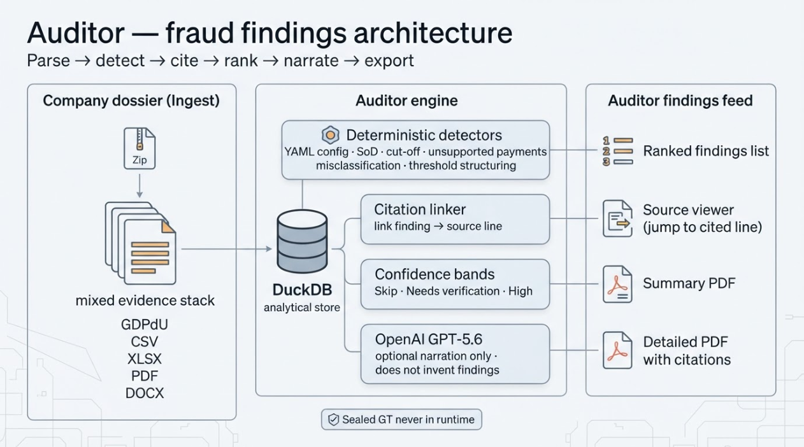

# Auditor Fraud Detection

## Description

Ranked fraud findings feed from company dossier zips — DuckDB detectors, citations, confidence bands, optional GPT-5.6 narration. Built for auditors, not dashboards.



## What judges should know

| Topic | Detail |
|-------|--------|
| Runtime path | Zip upload → deterministic parse → DuckDB detectors → confidence bands → optional OpenAI narration → SSE |
| Sealed GT | [`data/UEBUNG_GROUND-TRUTH_SEALED_Muster-Verpackungen.md`](data/UEBUNG_GROUND-TRUTH_SEALED_Muster-Verpackungen.md) is a **held-out eval fixture only**. It is never read by `app/backend/app/` or fed to the LLM. |
| Sample zip | [`data/Uebungsdaten_Muster_Verpackungen.zip`](data/Uebungsdaten_Muster_Verpackungen.zip) is the demo upload. A different zip should still run end-to-end. |
| LLM role | Narration, quote trim, policy/threshold extract — never invents findings or confidence % |

## Quick start

### Docker Compose (preferred)

```bash
cp .env.example .env   # optional OPENAI_API_KEY
docker compose up --build
```

- UI: http://127.0.0.1:5173
- API: http://127.0.0.1:8000

Compose e2e (upload + SSE):

```bash
bash app/backend/tests/compose_e2e.sh
```

### Dev without Docker

**Backend**

```bash
cd app/backend
python3 -m venv .venv && source .venv/bin/activate
pip install -r requirements.txt
uvicorn app.main:app --reload --port 8000
```

**Frontend** (Vite+ 1.4 / Bun 1.4.4; Node `^22.18 || ^24.11 || >=26`)

```bash
cd app/frontend
bun install
bun run dev      # vp dev
# bun run check  # fmt + lint
# bun run build
```

OpenAI env (see `.env.example`): `OPENAI_API_KEY`, `OPENAI_MODEL_PRIMARY=gpt-5.6`, `OPENAI_MODEL_FAST=gpt-5.6-terra`. Without a key, template narration still runs.

## Architecture

Detectors are config-driven and general — they transfer across dossiers via categories, not memorized sample IDs.

```
ZipUpload → Parse(GDPdU/CSV/XLSX/PDF/DOCX) → DuckDB
                ↓
         Category detectors (YAML) → Stage 2 citations → Confidence bands
                ↓
         Optional GPT-5.6 narrate → SSE → React findings list
```

Confidence: `clamp(0..100, base + statistical_strength + stage2_delta + multi_category_boost)`

| Band | Default | UI |
|------|---------|-----|
| Skip | `< 35%` | Hidden |
| Needs human verification | `35–65%` | Muted badge + Verify/Dismiss |
| High | `> 65%` | Ranked card |

## Adding a detector via config

1. Add parameters under a new key in [`app/backend/app/config/detectors.yaml`](app/backend/app/config/detectors.yaml) (thresholds, keyword categories, table-name substrings — **no dossier entity IDs**).
2. Implement `detect_<name>(conn, cfg)` in [`app/backend/app/detection/detectors.py`](app/backend/app/detection/detectors.py) returning `DetectorHit`s.
3. Register it in `run_all_detectors`.
4. Re-run eval (below). Prefer skip-band over noisy false positives.

## Sealed GT eval (offline, test-only)

```bash
cd app/backend
source .venv/bin/activate
python tests/eval_against_gt.py
```

This script alone may open the sealed GT file. Rubric matches the sealed file’s **Suggested scoring**:

| Weight | Rule |
|--------|------|
| Top marks | **F1** by *combining* sources + **F2/F3** profit-overstatement pair |
| Bonus | **F4** |
| Penalty | Accusing decoys **D1–D7** (−5 pts each on rubric, cap −30) |

Points: F1=40, F2=25, F3=25, F4=10. Do not “fix” eval by baking GT vendors/users into detectors.

## Repo layout

```
/
├── docker-compose.yml
├── docs/
│   ├── architecture.png
│   └── IMPLEMENTATION_PLAN.md
├── data/                 # sample zip + sealed GT (eval only)
└── app/
    ├── backend/          # FastAPI + DuckDB
    └── frontend/         # Bun 1.4.4 + Vite+ 1.4 (Vite 8) + React + TypeScript
```

## Smoke / regression

```bash
cd app/backend && source .venv/bin/activate
python tests/smoke_parse_sample.py
python tests/smoke_phase2_api.py
python tests/smoke_phase3_detectors.py
python tests/smoke_phase4_llm.py
python tests/eval_against_gt.py
```
