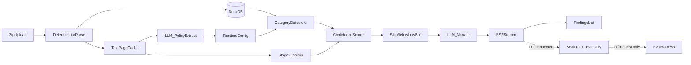

# Auditor Fraud Detection — Implementation Plan (canonical reference)

**Location:** this file is the in-repo plan you should open while working: [`docs/IMPLEMENTATION_PLAN.md`](IMPLEMENTATION_PLAN.md).

**Repo boundary:** workspace is `/home/aymen/projects/auditor-fraud-detection`. **All new project files go only inside this repo.**

**Overview:** Scaffold a clean `frontend/` + `backend/` monorepo with Docker Compose; config-driven FastAPI + DuckDB fraud detectors stream findings via SSE; React (Bun/Vite 8/TS strict) ranked findings feed; OpenAI gpt-5.6 narrates GT-style findings with confidence bands (skip / needs human verify / high confidence); LLM accelerates policy/schema assist — never replaces deterministic detection. General categories, not sample-dossier hardcodes. Sealed GT is eval-only, never training.

Follow [`.cursor/rules/karpathy-guidelines.mdc`](../.cursor/rules/karpathy-guidelines.mdc) on every phase: state assumptions, prefer simplicity, surgical diffs, verifiable success checks before moving on.

**Execution rule:** Run **one phase at a time**. When a phase’s Verify checklist passes, mark it done in this file, tell the user it is complete, and **stop**. Do not start the next phase until the user asks.

---

## Phase status

| Phase | Status | Summary |
|-------|--------|---------|
| 0 | done | In-repo plan + scaffold (compose, gitignore, README, backend/, frontend/) |
| 1 | done | Deterministic zip/GDPdU/CSV/XLSX/PDF/DOCX parse → DuckDB (no GT in code path) |
| 2 | done | Upload + SSE job pipeline + finding schema + verify/dismiss stubs |
| 3 | done | Six config-driven detectors + Stage 2 + confidence bands (no sample IDs) |
| 4 | done | OpenAI dual-tier narration/policy/quotes (Structured Outputs) |
| 5 | done | React Bun/Vite8/TS7 findings feed (confidence, human-verify, citations) |
| 6 | done | Eval harness vs sealed GT (test-only) + compose e2e + README for judges |

---

## Anti-bias rule (critical)

[`data/UEBUNG_GROUND-TRUTH_SEALED_Muster-Verpackungen.md`](../data/UEBUNG_GROUND-TRUTH_SEALED_Muster-Verpackungen.md) is a **held-out evaluation fixture**, not training data and not a product input.

| Allowed | Forbidden |
|---------|-----------|
| Use after a run as an **offline test / scoring script** (did we catch F1–F4? did we wrongly flag D1–D7?) | Import GT into detector code, YAML defaults, LLM system prompts, or few-shot examples |
| Emulate **document structure** only (headline + evidence bullets + citations) for UI/narrative shape | Hardcode vendor IDs, user IDs, amounts, dates, or beleg numbers from the sealed file |
| Keep file under `data/` and document “eval only” in README | Let the analysis API or upload pipeline read the GT file |
| Upload a **different** zip later and expect category detectors to transfer | Tune detectors to pass F1–F4 by memorizing entities |

**Implementation detail:** `backend/tests/eval_against_gt.py` (or similar) may load the sealed file **only in test/CI**, never from `app/` runtime. Runtime path: zip upload → parse → detect → score → stream. No GT on that path.

Config YAML may contain **generic** German accounting defaults (column names like `GEAENDERT_VON`, account class patterns, keyword *categories*). It must not contain sealed-dossier entity IDs.

---

## Sample zip formats (parsing expectations)

From [`data/Uebungsdaten_Muster_Verpackungen.zip`](../data/Uebungsdaten_Muster_Verpackungen.zip):

- **GDPdU TXT** — semicolon, quoted, German decimals, no header; columns from `index.xml`
- **CSV** — semicolon + headers
- **XLSX / PDF / DOCX** — present (keep all three parsers; DOCX is used for policy text)
- Folders: `Kreditoren/`, `Debitoren/`, `Sachkonten/`, `AV/`, `Begleitdokumente/`

---

## Product shape (findings feed)

SSE-streamed ranked list (no graph/dashboard). Each finding:

- GT-**style** headline + 2–4 sentence summary (tone only; content from detectors)
- Confidence % (deterministic formula)
- Band: skip / needs_human_verification / high
- Expandable citations `[1]`, `[2]` (file, row/page, quote)
- Verify / Dismiss

### Confidence bands (configurable defaults)

| Band | Default | UI |
|------|---------|-----|
| Skip | `< 35%` | Not shown |
| Needs human verify | `35–65%` | Muted + badge; Verify/Dismiss |
| High | `> 65%` | Normal ranked card |

### OpenAI

- Primary: `gpt-5.6` — narration + optional novel-pattern (secondary)
- Fast: `gpt-5.6-terra` — quotes, policy extract, optional schema aliases
- Structured Outputs always; LLM never invents finding existence or numeric confidence
- Do **not** feed sealed GT text to the model

### LLM vs deterministic

- **Deterministic:** zip/GDPdU/CSV/XLSX load, DuckDB detectors, confidence score, Stage 2 file locators
- **LLM assist:** narration, quote trim, policy threshold extract, optional schema aliases, secondary novel pass

---

## Repo layout

```
/
├── docker-compose.yml
├── .gitignore
├── README.md
├── docs/
│   └── IMPLEMENTATION_PLAN.md   # this file
├── data/                        # sample zip + sealed GT (eval only)
└── app/
    ├── backend/
    │   ├── Dockerfile
    │   ├── app/ ...             # FastAPI package (sealed GT never imported here)
    │   └── tests/               # includes eval_against_gt.py (test-only)
    └── frontend/                # bun + Vite+ / vite 8 + react + typescript strict
```

---

## Architecture



---

## Phases and agent prompts

Each phase prompt is copy-pasteable. Follow Karpathy: state assumptions → minimal code → verify checklist → stop.

### Phase 0 — Reference doc + scaffold

**Goal:** Durable plan in-repo; empty monorepo skeleton ready.

**Verify:** `docs/IMPLEMENTATION_PLAN.md` exists; `frontend/` + `backend/` + `docker-compose.yml` + `.gitignore` present; no detector logic yet.

**Prompt:**

```text
Phase 0 of auditor-fraud-detection (see docs/IMPLEMENTATION_PLAN.md).

Follow .cursor/rules/karpathy-guidelines.mdc: assumptions first, minimal code, surgical changes, verifiable checks.

Tasks:
1. Ensure docs/IMPLEMENTATION_PLAN.md is the durable in-repo plan (anti-bias: sealed GT is eval-only).
2. Create clean monorepo root: docker-compose.yml, .gitignore, README skeleton, backend/ (FastAPI placeholder), frontend/ (Bun + Vite 8 + React + TypeScript 7 strict).
3. Do NOT implement detectors, do NOT read sealed GT into app code, do NOT add sample vendor/user IDs anywhere.

Verify: tree matches plan layout; bun frontend typechecks; backend imports; compose config validates.
```

### Phase 1 — Deterministic parsing → DuckDB

**Goal:** Upload zip loads into DuckDB + doc text cache. No findings yet.

**Verify:** Sample zip loads; table row counts sane; PDF/DOCX text cached with locators; no OpenAI required.

**Prompt:**

```text
Phase 1 — parsing only.

Implement zip extract, GDPdU index.xml→TXT loader, CSV/XLSX loaders, PDF/DOCX text+page cache, DuckDB session DB.
German decimals/dates normalized in one helper. Column aliases via config only (generic names).

Forbidden: reading UEBUNG_GROUND-TRUTH_SEALED_*.md from app/; any fraud detector; any hardcoded dossier IDs.

Verify: load data/Uebungsdaten_Muster_Verpackungen.zip in a smoke script/test; print table names + row counts; cite one PDF/DOCX page extract.
```

### Phase 2 — Upload API + SSE pipeline

**Goal:** Job lifecycle streams placeholder/raw findings; Verify/Dismiss endpoints exist.

**Verify:** Upload returns job_id; EventSource receives ordered events; verdicts persist for job.

**Prompt:**

```text
Phase 2 — API + SSE.

POST /api/upload → job_id; GET /api/analyze/{job_id}/stream (SSE); POST findings verdict verify/dismiss.
Finding event schema: id, title, summary, confidence, band, categories[], citations[{n,file,locator,quote}], status.
For now emit stub/raw detector-shaped events after parse (or empty list) — wire streaming + sort contract.

No GT file access. Keep Karpathy-simple. Verify with curl/EventSource against sample zip upload.
```

### Phase 3 — Config-driven detectors + scoring

**Goal:** Six category detectors + Stage 2 + confidence bands. General patterns only.

**Verify:** Detectors fire from YAML params; scores explainable; skip band not emitted; no sealed IDs in `app/` or default YAML entity lists.

**Prompt:**

```text
Phase 3 — detectors + confidence.

Implement config-driven detectors: segregation_of_duties, misclassification, cutoff_timing, threshold_structuring, near_duplicate_entities, unsupported_transaction.
Stage 2 corroboration from XLSX/PDF/DOCX cache → citations + score delta.
Confidence = base + statistical_strength + stage2_delta + multi_category_boost; bands skip<35, review 35–65, high>65 (config).

FORBIDDEN: vendor/user/amount IDs from sealed GT in Python or as “known fraud” lists. YAML = generic column maps, keyword categories, thresholds as parameters — not dossier memorization.
Do not open the sealed GT in this phase. Eval is Phase 6 only.

Verify: run on sample zip; manually spot-check a few citations resolve to real files/rows; confirm skip filter works.
```

### Phase 4 — OpenAI narration / policy / quotes

**Goal:** GT-**style** language without GT content leakage.

**Verify:** Narratives use Structured Outputs; offline fallback works without API key; prompts contain no sealed GT excerpts.

**Prompt:**

```text
Phase 4 — OpenAI dual-tier.

OPENAI_MODEL_PRIMARY=gpt-5.6 (narration, optional novel-pattern secondary).
OPENAI_MODEL_FAST=gpt-5.6-terra (quote pick, one-shot policy/threshold extract).
Structured Outputs only. LLM must not set confidence % or invent findings without detector origin + real citation text already retrieved.
Never include sealed GT file contents in prompts or few-shots. Style = “audit headline + short evidence story” only.

Verify: with key, one finding narrates; without key, template fallback; grep prompts/repo for sealed entity IDs (209101, MV-U05, etc.) → zero hits in app/.
```

### Phase 5 — React findings feed

**Goal:** Live ranked list UX.

**Verify:** SSE inserts reorder by confidence; mid-band muted “Needs human verification”; skip never shown; citations expand; Verify/Dismiss work.

**Prompt:**

```text
Phase 5 — frontend.

Bun + Vite 8 + React + TypeScript 7 strict. Upload UI + SSE FindingsList with reorder animation, confidence %, band badge, expandable [n] citations, Verify/Dismiss.
No graph/dashboard libraries. Proxy /api to backend.

Verify: upload sample zip; watch findings stream and re-rank; mid-band styling visible; citations expand to file/locator/quote.
```

### Phase 6 — Eval harness (GT as test) + ship

**Goal:** Offline scoring against sealed GT; docs for judges; compose e2e.

**Verify:** Eval script reports hits on expected *categories/patterns* and decoy false-positive rate; README states GT is eval-only; different zip still runs end-to-end.

**Prompt:**

```text
Phase 6 — eval + docs (GT is TEST ONLY).

Add backend/tests/eval_against_gt.py that:
- Runs analysis on sample zip via the same runtime APIs/modules as production
- Compares findings to data/UEBUNG_GROUND-TRUTH_SEALED_Muster-Verpackungen.md ONLY inside this test
- Scores: catch F1–F4 style outcomes by pattern/category signals (not by asserting hardcoded vendor IDs in detectors)
- Fails or warns on decoy-like false positives when detectable
- Is never imported by app/ runtime

Polish README: setup, architecture, how to add a detector via config, confidence bands, OpenAI env, explicit “sealed GT = held-out eval”.
Docker compose e2e. Do not “fix” failing eval by baking GT entities into detectors — fix general logic/config instead.

Verify: eval script runs; compose up works; grep app/ for sealed IDs still clean.
```

---

## Detector categories (config-driven)

- segregation_of_duties
- misclassification
- cutoff_timing
- threshold_structuring
- near_duplicate_entities
- unsupported_transaction

Confidence formula (document in code):

```
score = clamp(0..100, base + statistical_strength + stage2_delta + multi_category_boost)
band = skip | needs_human_verification | high
```

---

## Karpathy checklist (every phase)

1. State assumptions; ask if schema unclear — do not silently invent columns.
2. Minimum code; no speculative abstractions.
3. Touch only files needed for the phase.
4. Success = the phase **Verify** bullets, not “looks done.”

---

## Bias / generalization guardrails (summary)

- Sealed GT = offline eval only (Phase 6).
- No sample entity IDs in `app/` or LLM prompts.
- Judging zip will differ; detectors must transfer via categories + config.
- False positives (decoys) are costly — prefer skip band over noisy feed.
